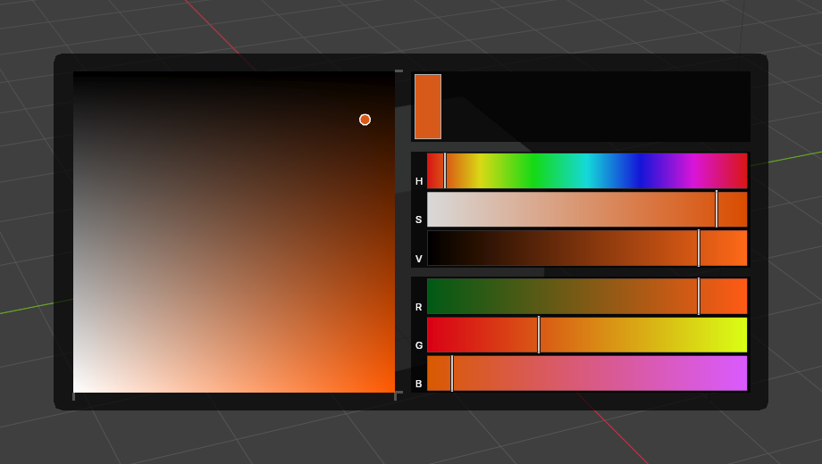
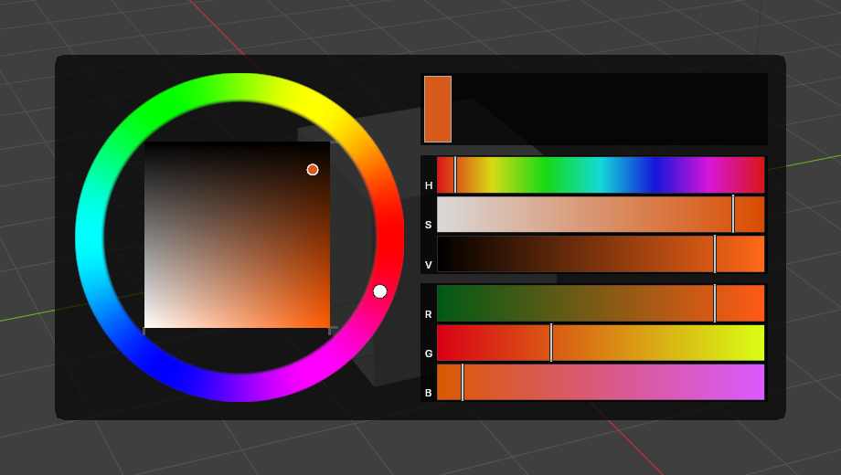
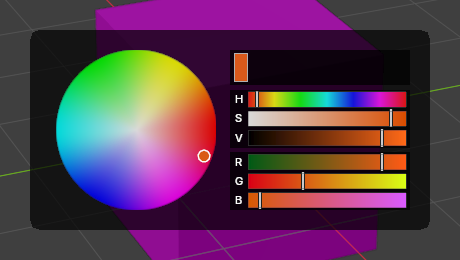
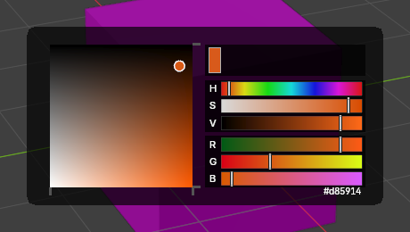
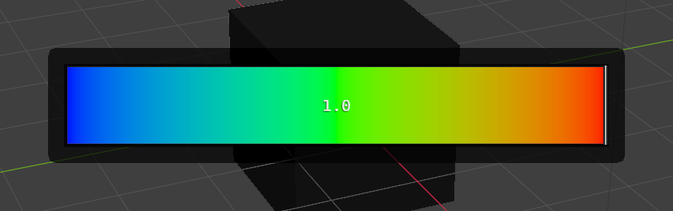
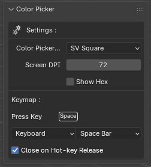

# Color Picker

A quick color picker for Blender's paint modes. Press a hotkey in the 3D Viewport and a compact picker opens under your mouse, so you can change the brush color or weight without going to the tool header or the sidebar.

It works in **Texture Paint**, **Vertex Paint** and **Weight Paint**.

## Installation

**Blender 5.0 and newer** (tested in 5.3):

1. Download `ColorPicker_v1.3.0_(Blender_5.3).zip` from the [`releases`](releases) folder.
2. In Blender, go to *Edit > Preferences > Get Extensions*, open the menu in the top-right corner and choose *Install from Disk…*, then select the zip. You can also drag and drop the zip into Blender.

Older builds for Blender 2.93, 3.x and 4.x are also in the [`releases`](releases) folder.

## Usage

1. Enter Texture Paint, Vertex Paint or Weight Paint mode.
2. Hover over the 3D Viewport and **hold `Space`**. The picker opens under your mouse.
3. Click or drag on the picker to choose a color. The brush updates right away.
4. **Release `Space`** to close the picker.

You can also close it with `Esc`. If you turn off *Close on Hot-key Release*, the picker stays open after you release the key. Then press `Space` again or click outside the picker to close it.

The picker edits the same color Blender's brush uses. If *Unified Color* is on, it changes the shared color; otherwise it changes the active brush's own color.

## Picker layouts

Choose a layout under *Color Picker Type* in the settings (see [Settings](#settings)). Every layout has the same panel on the right:

- **Color preview** at the top.
- **H / S / V sliders** for hue, saturation and value.
- **R / G / B sliders** for the red, green and blue channels.

Every slider shows a live gradient of the colors you would get by moving it, so you can see the result before you drag.

### SV Square

A square where the horizontal axis is **saturation** and the vertical axis is **value** (brightness). Use the H slider to change the hue. This is the default layout.

### SV+H Square & Ring

The same saturation/value square, inside a **hue ring**. Drag around the ring to change the hue and inside the square to set saturation and value, all without using the sliders.

### HS Circle

A color wheel: the angle sets the **hue** and the distance from the center sets the **saturation**. Use the V slider to change the brightness.

### Hex code

Turn on *Show Hex* to show the current color as a hexadecimal code (for example `#d85914`) under the sliders.

### Weight Paint

In Weight Paint mode the picker is a single **weight bar**: a blue-to-red gradient from 0.0 to 1.0, with the current value shown in the middle. Click or drag along it to set the brush weight.

## Settings

The settings are in the 3D Viewport sidebar (`N`), under *Paint > Color Picker*, while you are in a paint mode. The same options are also in the add-on's preferences.

| Setting | What it does |
| --- | --- |
| Color Picker Type | Picks the layout: SV Square, SV+H Square & Ring, or HS Circle. |
| Keymap | The key that opens the picker (`Space` by default). You can set it separately for each paint mode. |
| Close on Hot-key Release | When on, the picker closes as soon as you release the key. When off, it stays open until you press the key again, click outside it, or press `Esc`. |
| Screen DPI | Scales the picker's text and widgets. Raise it on high-resolution screens. |
| Scale Factor | Extra size multiplier for the picker (0.5–2), applied on top of Screen DPI. Only in the add-on's preferences. |
| Show Hex | Shows the color's hex code in the picker. |

## License

GPL-3.0. See [LICENSE](LICENSE).
